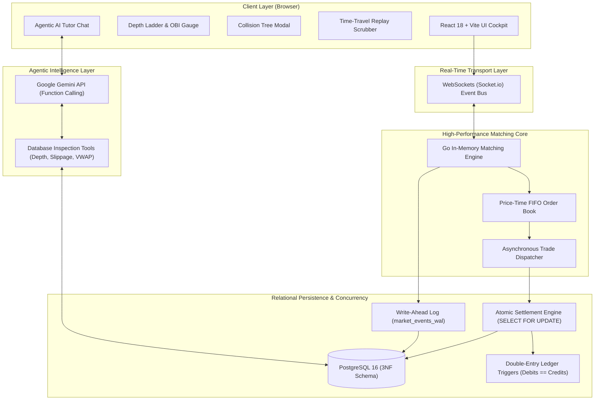

# Glass-Box: Interactive Multi-Symbol Market Microstructure & ACID Transaction Simulator with Agentic AI

### Milestone-1: Project Proposal, Requirements & Feasibility

- **Course & Context:** Major Project / Capstone Specification (Milestone 1)
- **Institution:** School of Computer Science Engineering & Technology (SCSET), Bennett University
- **Academic Program:** Bachelor of Computer Applications (BCA)
- **Team Members:**
  - Apoorva Pandey (`S24BCAU0120`)
  - Sameer Bhati (`S24BCAU0106`)
- **Submission Deadline:** 18 October 2026 | **Evaluation Weight:** 30 Marks

---

### Deliverable content breakdown

```
┌────────────────────────────────────────────────────────────────────────────────────────┐
│                        Milestone 1 content layout                                      │
├────────────────────────────────────────────────────────────────────────────────────────┤
│ 1. Problem and context    │ Problem statement, background, literature, gap analysis    │
│ 2. People and impact      │ Stakeholders, user requirements, SDG alignment             │
│ 3. System specification   │ Proposed solution, FRs and NFRs, tech choices              │
│ 4. Viability and bounds   │ Feasibility (tech, cost, ops, legal), scope and limits     │
│ 5. Execution planning     │ Risk matrix, WBS, timeline, success criteria               │
│ 6. Academic foundation    │ References (IEEE and APA format)                           │
└────────────────────────────────────────────────────────────────────────────────────────┘
```

---

#### 1. Final problem statement and motivation

Most retail trading simulators like TradingView paper trading or Moneybhai let people submit simulated buy and sell orders, but they conceal the internal mechanics of the exchange. Users cannot inspect order queue priority, examine counterparty allocation, observe order book depth changes, or see why aggressive market orders incur severe price slippage when liquidity thins out. The exchange operates as an opaque black box returning only a single aggregated confirmation price.

Simultaneously, computer science curricula typically introduce database concurrency control and ACID transactions through simplistic toy scenarios such as a single balance transfer from Account A to Account B. This fails to expose students to high-contention enterprise database dynamics, where concurrent multi-party order sweeps contend for the same row locks, multi-account settlements must commit atomically across $k+1$ portfolios, and in-memory matching speeds directly conflict with disk write latency.

Because of this dual educational disconnect, **Glass-Box** is proposed as an open-source, web-native educational electronic exchange, market microstructure simulator, and database concurrency laboratory. It exposes continuous double auction internals, displays row-level lock contention in PostgreSQL, and integrates an agentic AI tutor to provide mathematically grounded explanations of live market dynamics.

---

#### 2. Background and context

Markets operate by matching bids and asks in an order book using price-time priority, which simply means that better prices get filled first and orders at the identical price level get processed in the order they arrived.
Bids are what buyers want to pay. Asks are what sellers want to get.
The spread between them widens when liquidity dries up, and when someone drops a large market order into thin book depth, prices degrade across price tiers, producing slippage and changing the average price. That changes execution cost. In India, equity exchanges like NSE operate with specific constraints including a tick size of 5 paise, single-share lot sizes, and daily price bands that limit swings to ten percent. We use symbols like TCS, INFY, RELIANCE, and HDFCBANK as mock instruments so the environment feels familiar. On the database side, memory matching runs in microseconds while relational disk persistence takes milliseconds, creating an interesting throughput bottleneck where memory state has to stay aligned with PostgreSQL tables. Things get out of sync easily if not handled carefully.

---

#### 3. Literature and existing solution review

There are already several types of tools available, though each category leaves out parts of what we want to demonstrate. We looked at three of them.

1. Commercial paper trading apps:
   Platforms like TradingView, Moneybhai, and NSE Paathshaala focus on technical analysis and charting indicators. They treat order fulfillment as an instant fill at whatever the last traded price was, meaning they skip simulated queue positions, slippage across multiple price tiers, and internal transaction logs. The server code is closed source. You cannot see how trades settle.

2. Academic simulation engines:
   Systems like ABIDES or PyLOB simulate limit order books in detail, often with automated trading agents written for research papers. They are usually command-line tools written in Python or C++, often configured for US market settings, and setting them up takes work since they do not come with web interfaces or links to database learning. They work well for machine learning experiments, but are hard for beginners to inspect.

3. Institutional and classroom trading simulators:
   Platforms like Stevens SHIFT (Stevens High Frequency Trading Simulation System), FTS Interactive Markets, and Rotman Interactive Trader (RIT) simulate electronic exchanges for university finance courses and trading competitions. However, these tools are built strictly from an external _market participant's_ viewpoint students send orders to a closed binary via client tickets or FIX APIs without access to the matching engine's internal queues or database transactions. In addition, they are proprietary, expensive to license, US-centric, and run as legacy desktop software rather than open-source, web-native systems.

---

#### 4. Gap analysis

Existing options hide the exchange internals. Glass-Box inverts this paradigm, allowing students to inspect both the matching queue and database transaction execution in real time.

| Dimension                       | Retail paper trading (TradingView, Moneybhai) | Academic engines (ABIDES, PyLOB) | Institutional simulators (Stevens SHIFT, FTS) | Glass-Box (this project)                     |
| :------------------------------ | :-------------------------------------------- | :------------------------------- | :-------------------------------------------- | :------------------------------------------- |
| Matching queue visibility       | Hidden behind chart interface                 | Terminal logs or text files      | Proprietary client / API depth only           | Visual depth ladder with queue rank          |
| Partial fill and slippage trace | Single average fill price                     | Raw event logs                   | Aggregated fill confirmation                  | Step-by-step collision tree breakdown modal  |
| ACID transaction inspection     | None                                          | None                             | None (In-memory / Proprietary)                | PostgreSQL tables with row locking queries   |
| Double-entry accounting checks  | Basic balance subtraction                     | None                             | Hidden internal accounting                    | Ledger entries checking debits equal credits |
| Crash recovery check            | Not simulated                                 | Available                        | Not exposed to students                       | Replaying events from a write-ahead log      |
| Interactive AI assistant        | Generic chatbot or none                       | None                             | None                                          | LLM querying live database state via tools   |
| Accessibility & Cost            | Closed proprietary web apps                   | CLI scripts (complex setup)      | Expensive commercial licenses                 | Browser interface with open source (MIT)     |

---

#### 5. Stakeholder and target user analysis

Different groups of users have distinct reasons to care about this kind of setup. Computer science and BCA students studying database management need concrete examples of transaction isolation, row locks, and how write-ahead logs recover data after an unexpected process crash. While finance and business students often want to observe how bid-ask spreads fluctuate, what happens when an aggressive order eats through resting liquidity, and how volume-weighted average price gets calculated across multiple fills. They do not need to read database query plans. Faculty and lab instructors benefit from having pre-built lab exercises where they can intentionally simulate a crash, allowing students to observe recovery without writing complex code themselves. Small fintech teams or hobbyist algo developers could also use it as a lightweight sandbox to test order logic locally before connecting to production APIs. It avoids exchange fees.

---

#### 6. Customer and user requirements

The functional requirements can be expressed through realistic user scenarios.

- As a computer science student, I want to send multiple market orders at once so that I can see PostgreSQL row lock waits and isolation level rollbacks happen on screen.
- As a finance student, I want to watch an incoming market order sweep through several price levels so that I can see how slippage and volume-weighted pricing actually work.
- As a student trying to understand a sudden price change, I want an AI helper that can call database query tools to check depth and recent trades before answering, so that the explanation is based on actual recorded data.
- As an instructor running a lab, I want to simulate an engine crash by killing the process so that students can test whether the write-ahead log restores the state properly.

---

#### 7. SDG mapping and rationale

- SDG 4: Quality education (target 4.4):
  The simulator provides an open source laboratory where students can experiment with financial market mechanisms and database internals directly in a browser without paying software licensing costs. Interactive tools tend to help practical understanding.

- SDG 8: Decent work and economic growth (targets 8.2 and 8.10):
  Learning both backend database engineering and market microstructure concepts helps students build skills relevant to financial technology software development. Fintech systems require careful transaction handling.

- SDG 9: Industry, innovation and infrastructure (targets 9.5 and 9.b):
  Building an inspectable educational exchange tool supports local technology training and reduces the need for expensive proprietary software for classroom demonstrations. Code is open for anyone to inspect.

---

#### 8. Proposed solution and methodology

The project is split into four main architectural layers that interact over local and WebSocket network connections:



- **The In-Memory Matching Engine (Go):** Maintained in-memory using doubly linked lists and hash maps to enforce price-time priority (FIFO) execution with sub-10-microsecond matching latency.
- **Relational Persistence & Atomic Settlement (PostgreSQL 3NF):** An asynchronous pipeline transfers executed trades to PostgreSQL. A normalized third-normal-form schema executes multi-counterparty atomic settlements across $k+1$ accounts under pessimistic row-level locking (`SELECT ... FOR UPDATE`).
- **Auditability & Financial Invariants:** A bank-grade double-entry ledger table (`ledger_entries`) verifies mathematical balance equality ($\sum \text{Debits} \equiv \sum \text{Credits}$) and `CHECK (balance >= 0)` constraints.
- **Write-Ahead Log (WAL) & Crash Recovery:** An append-only table (`market_events_wal`) records every event sequentially; an automated recovery script replays uncommitted events into RAM upon server restart (`kill -9`).
- **Agentic AI Market Tutor:** Embedded Google Gemini model equipped with structured tool-calling functions (`get_orderbook_depth`, `calculate_slippage`, `inspect_recent_trades`) to analyze live database state and deliver mathematically grounded causal explanations.
- **Frontend Dashboard:** Built with React 18 and Vite, streaming real-time depth ladders, Order Book Imbalance (OBI) gauges, collision tree execution traces, and latency telemetry over WebSockets.

For methodology, development follows an **Agile / Scrum framework** with 2-week sprint cadences and Test-Driven Development (TDD) for financial invariants and matching correctness.

---

#### 9. Functional and non-functional requirements

The requirements separate baseline exchange operations from educational inspection features.

Functional requirements:

- Baseline features include submitting limit and market orders, rendering real-time order book depth for multiple symbols, tracking user portfolios, and handling order cancellations cleanly.
- Orders must cancel without ghost entries.
- Educational features include a step-by-step collision tree modal that unpacks how a single order swept multiple bids, an AI tutor with database query tools, tick-by-tick time travel playback, and an automated recovery test that replays events from write-ahead logs.
- Users can also tweak engine parameters like tick size to see how spreads react.

Non-functional requirements:

- Throughput: The in-memory matching engine should process at least 50,000 orders per second, while PostgreSQL settlement should handle at least 1,000 multi-party transactions per second under simulated load.
- Latency: Memory matching should complete within microseconds, database transaction commits should generally stay below 15 milliseconds, and WebSocket updates to the browser should take under 30 milliseconds.
- Fast UI updates prevent lag.
- Consistency: Balance tables must strictly satisfy debit and credit equality, with database check constraints preventing negative balances or unbacked share transfers.
- Recovery: When the backend process terminates unexpectedly, replaying the write-ahead log should restore the order book state in under five seconds with zero lost trades.
- Accessibility: The application should run in standard modern browsers without extra software installs.

---

#### 10. Technology and tool selection with justification

Here is how the core tech stack was chosen based on trade-offs between complexity and performance.

| Component           | Selected tool      | Alternatives considered   | Reasoning and trade-offs                                                                                                                         |
| :------------------ | :----------------- | :------------------------ | :----------------------------------------------------------------------------------------------------------------------------------------------- |
| Matching engine     | Go                 | C++, Node.js              | Go offers fast goroutines and pointer manipulation without manual memory management headaches typical of C++.                                    |
| Relational database | PostgreSQL 16      | Redis, MongoDB            | Strong ACID support, pessimistic row locking with `FOR UPDATE`, and reliable check constraints outweigh the raw write speed of key-value stores. |
| AI assistant        | Google Gemini API  | Local open weights LLMs   | Structured function calling works out of the box and avoids needing dedicated GPU hardware for local model inference.                            |
| Web frontend        | React 18 with Vite | Next.js, plain JavaScript | Vite provides quick build times and React handles dynamic state updates from high-frequency WebSocket streams cleanly.                           |
| Communication layer | WebSockets         | HTTP REST polling         | Bidirectional socket streaming gives lower latency for live depth book changes than repeated polling requests.                                   |

We considered running everything in Node.js initially, but separating high-speed matching in Go from persistence in PostgreSQL gives a much better demonstration of realistic systems architecture. Node handles the API glue easily.

---

#### 11. Feasibility study (technical, economic, operational, legal and ethical)

Feasibility looks reasonable across the main areas considered.

- Technical feasibility:
  The core Go matching engine and early Node server benchmarks are already functioning in the project repository. PostgreSQL handles row locking and transactions predictably, and integrating the Gemini API for tool calling is straightforward using standard REST endpoints, so the technical risk is manageable. The pieces already communicate.

- Economic feasibility:
  The financial cost to build and run this project is practically zero. All libraries, databases, and programming languages used are open source, and the entire system can run locally on student laptops or within free hosting tiers on platforms like Render if volume is low. However, a low to medium cost dedicated instance may be required if larger volumes of trading are expected.

- Operational feasibility:
  University computer labs only need a web browser and Docker or Node installed to run the lab modules. The interface is designed so students can follow guided lab steps without needing deep terminal expertise.

- Legal and ethical considerations:
  The application is purely educational and does not connect to real financial markets, handle real money, or execute orders through regulated brokers. Clear disclaimers will state that this is a simulated sandbox. We use synthetic order data and publicly known stock tickers without storing personal user information. Privacy risk is minimal.

---

#### 12. Scope, exclusions, and limitations

Defining boundaries early prevents the project from becoming too broad.

Included in scope:

- Continuous double auction matching for four Indian stock symbols including TCS, INFY, RELIANCE, and HDFCBANK.
- Limit and market orders handled with price-time priority.
- Multi-party atomic trade settlement in PostgreSQL with double-entry ledger.
- AI tutoring agent with database query tools to inspect live depth and past executions.
- Replay crash recovery testing via write-ahead logs.

Excluded from scope:

- Options and futures pricing such as Black-Scholes formulas.
- Live connectivity to actual exchange networks via FIX protocol.
- Margin lending, short selling mechanics, or automated collateral liquidation.
- Distributed consensus protocols like Raft across multiple engine nodes. This was initially considered, however, Raft exceeded project complexity, hence it was excluded.

Limitations:
The architecture runs on a single primary node, meaning distributed replication is not addressed in this milestone. Browser rendering also has practical limits, so WebSocket updates are capped at 60 frames per second to avoid UI stutter. Browsers drop frames because of heavy DOM painting.

---

#### 13. Risk analysis and mitigation strategy

| Risk description                                        | Type      | Likelihood | Impact | Planned mitigation                                                                                           |
| :------------------------------------------------------ | :-------- | :--------- | :----- | :----------------------------------------------------------------------------------------------------------- |
| Database deadlocks during multi-seller settlement       | Technical | Medium     | High   | Sort row locks deterministically by user ID and symbol ID before executing `SELECT FOR UPDATE`.              |
| AI hallucination when explaining market state           | Technical | High       | High   | Restrict the model to tool calling so answers require data returned from actual database queries.            |
| Inconsistency between memory book and PostgreSQL tables | Technical | Medium     | High   | Maintain a sequence number in the event log to detect missing or reordered records.                          |
| Scope creep into complex financial derivatives          | Project   | High       | Medium | Keep derivatives strictly off the task list until core matching and settlement are finished.                 |
| Uneven work distribution among teammates                | Team      | Low        | Low    | Assign separate module ownership for backend matching and frontend visualizations with GitHub pull requests. |

Multi-seller sweeps are vulnerable to cyclic deadlocks if portfolio and holding rows are locked out of sequence. To systematically prevent circular-wait conditions, our transaction pipeline enforces deterministic lock acquisition ordering by sorting account IDs prior to issuing `SELECT ... FOR UPDATE`.

---

#### 14. Work breakdown structure (WBS)

The project scope is structured into six hierarchical work packages (WBS 1.0 to 6.0), each with defined, testable deliverables:

- **1.0 Project Planning, Requirements & Systems Architecture**
  - 1.1 Problem formulation, academic literature review, and gap analysis
  - 1.2 System specification, non-functional latency/throughput budgets, and SDG alignment
  - 1.3 Ethics, regulatory boundary definition (SEBI circulars), and sandbox disclaimer drafting

- **2.0 High-Performance In-Memory Matching Core**
  - 2.1 Order object modeling (limit, market, cancellation) and multi-symbol state routing
  - 2.2 Doubly-linked list + hash map FIFO price-time priority order book implementation
  - 2.3 Synthetic burst generation harness and microsecond-level matching benchmark suite

- **3.0 Relational Persistence & Concurrency Settlement Layer (PostgreSQL 3NF)**
  - 3.1 3NF relational schema design (users, portfolios, securities_holdings, orders, trades)
  - 3.2 Atomic multi-party settlement engine with deterministic pessimistic locking (`SELECT ... FOR UPDATE`)
  - 3.3 Double-entry ledger journal (`ledger_entries`) with database balance invariant triggers ($\sum \text{Debits} \equiv \sum \text{Credits}$)
  - 3.4 Append-only Write-Ahead Log (`market_events_wal`) and automated state replay routine for crash recovery

- **4.0 Frontend Educational Dashboard & Microstructure Visualizations (React + Vite)**
  - 4.1 Real-time depth ladder and animated Order Book Imbalance (OBI) gauge
  - 4.2 Interactive "Glass-Box" Collision Tree execution trace modal (queue rank, VWAP, slippage breakdown)
  - 4.3 Tick-by-tick deterministic time-travel scrubber bar ($0.25\times$, $0.5\times$, $1.0\times$ replay)
  - 4.4 Systems latency telemetry cockpit (in-memory matching vs. database commit vs. network transport)

- **5.0 Agentic AI Market Microstructure Tutor (Google Gemini API)**
  - 5.1 Structured function-calling tool definition (`get_orderbook_depth`, `calculate_slippage`, `inspect_recent_trades`)
  - 5.2 Contextual prompt engineering to eliminate financial hallucination and enforce database-grounded explanations
  - 5.3 Conversational tutor UI integration within the dashboard

- **6.0 Verification, Concurrency Benchmarking & Empirical Trials**
  - 6.1 Parallel concurrency test suite (50+ simultaneous market orders evaluating lock contention and rollbacks)
  - 6.2 Simulated process crash (`kill -9`) durability verification and recovery time objective (RTO) benchmarking
  - 6.3 Pilot lab trial execution with student cohort and quantitative pedagogical clarity evaluation

---

#### 15. Project timeline and expected deliverables

The work is laid out across twelve weeks divided into four development sprints.

Sprint breakdown:

- Sprint 1 (Weeks 1 to 3): Basic matching engine, limit order queues, and initial Go benchmarks. Done.
- Sprint 2 (Weeks 4 to 6): PostgreSQL 3NF schema, atomic multi-party settlement, and double-entry triggers. Current focus.
- Sprint 3 (Weeks 7 to 9): Gemini tool calling endpoints and the visual collision tree breakdown component. Upcoming.
- Sprint 4 (Weeks 10 to 12): Crash recovery replay verification, concurrency stress testing, and user feedback collection. Final sprint.

Dates might shift slightly depending on complexity that arises during the project.

---

#### 16. Expected outcomes and success criteria

Success will be measured by both technical reliability and how clearly user can follow the concepts.

Technical targets:

- State restoration from the write-ahead log should recover all confirmed trades after a sudden engine kill.
- Account balances must maintain strict debit-credit equality without negative balances appearing under concurrent load.
- In-memory matching should comfortably exceed 50,000 orders per second in local benchmarks.
- Numbers should stay stable under test.

Educational targets:

- Students in lab sessions should be able to trigger row lock contention and explain why the delay occurred using the UI telemetry.
- The AI assistant should correctly answer student queries about slippage and order depth using live database tool outputs.
- Post-lab surveys aim for over 80 percent positive ratings regarding conceptual clarity of database concurrency and order matching mechanics.
- Feedback will help refine the UI.

---

#### 17. References

1. Glosten, L. R., and Milgrom, P. R. (1985). Bid, ask and transaction prices in a specialist market with heterogeneously informed traders. Journal of Financial Economics, 14(1), 71-100.
2. Securities and Exchange Board of India. (2023). Master circular for stock exchanges and clearing corporations.
3. Kleppmann, M. (2017). Designing data-intensive applications: the big ideas behind reliable, scalable, and maintainable systems. O'Reilly Media.
4. Harris, L. (2003). Trading and exchanges: market microstructure for practitioners. Oxford University Press.
