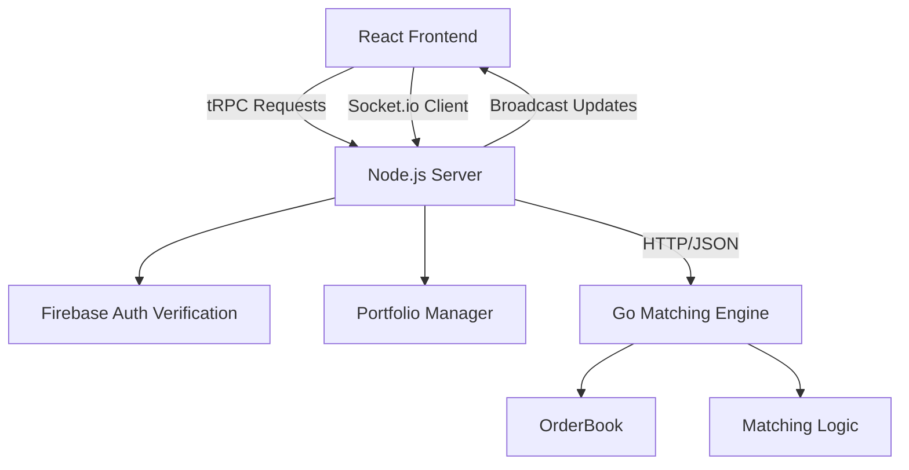
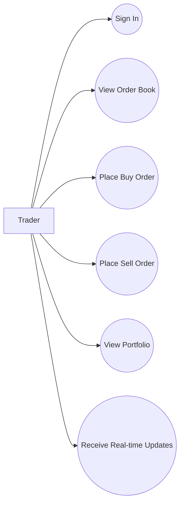
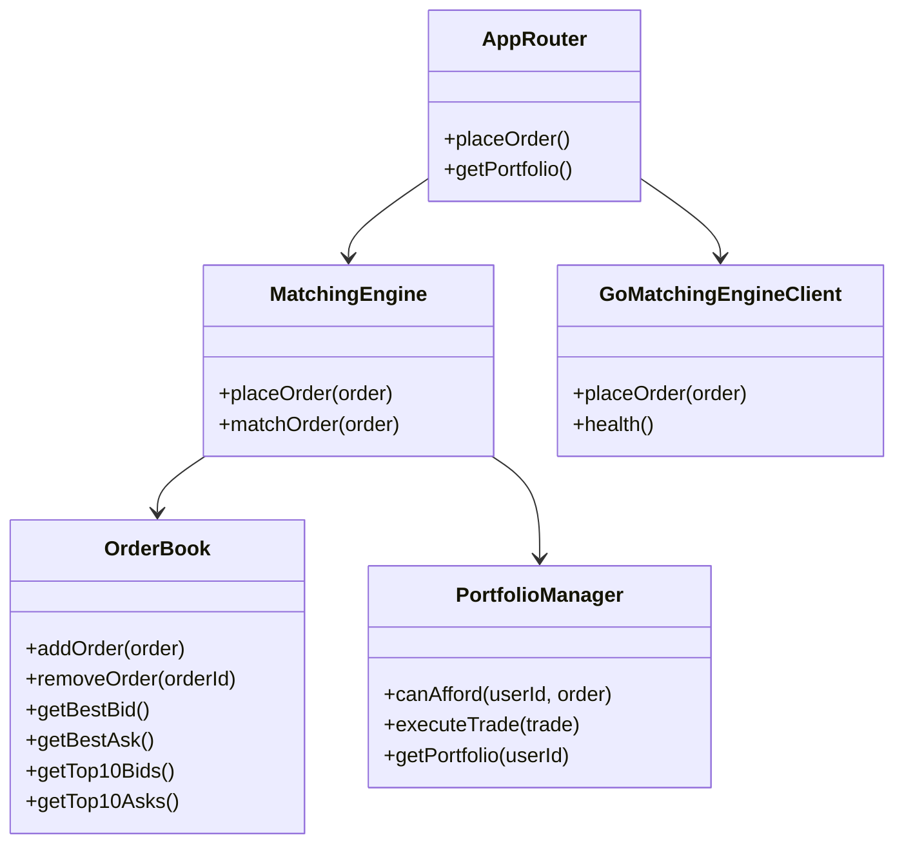
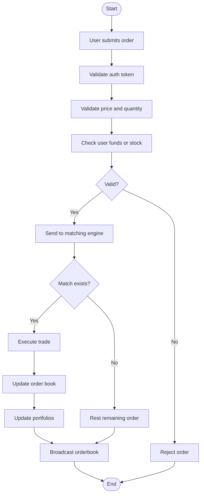
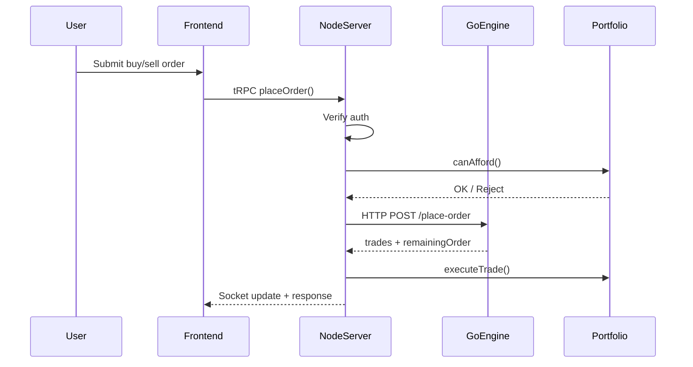
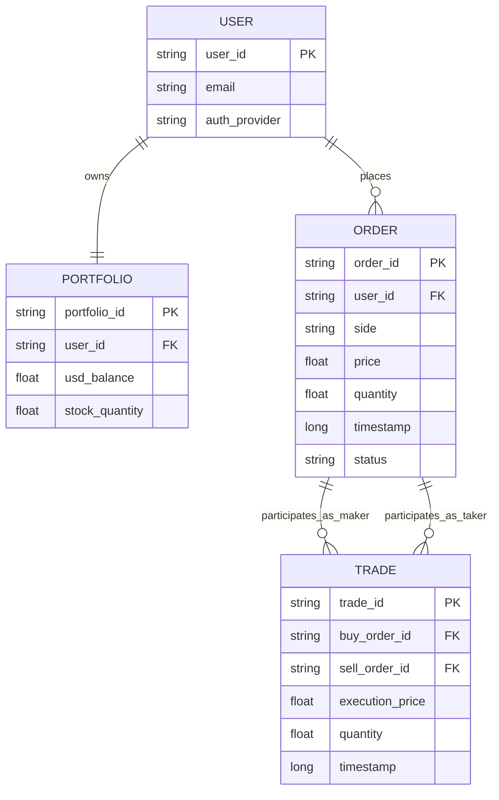

# STOCK ORDER BOOK WITH REAL-TIME MATCHING ENGINE

## A PROJECT REPORT

**BY**

**TEAM NO. 54**

**Member 1 Name (Enrollment No.)**  
**Member 2 Name (Enrollment No.)**  
**Member 3 Name (Enrollment No.)**  
**Member 4 Name (Enrollment No.)**

**SUBMITTED TO**

**SCHOOL OF COMPUTER SCIENCE ENGINEERING AND TECHNOLOGY, BENNETT UNIVERSITY**  
**GREATER NOIDA, 201310, UTTAR PRADESH, INDIA**

**May 2026**

---

# DECLARATION

I/We hereby declare that the work presented in this report entitled **"Stock Order Book with Real-Time Matching Engine"** is an authentic record of our own work carried out at School of Computer Science Engineering and Technology, Bennett University, Greater Noida.

The matter and results presented in this report have not been submitted by us for the award of any other degree or diploma elsewhere.

**Signature of Candidate(s)**

**Name of Teammate 1**  
(Enroll. No. **\_\_\_\_**)

**Name of Teammate 2**  
(Enroll. No. **\_\_\_\_**)

**Name of Teammate 3**  
(Enroll. No. **\_\_\_\_**)

**Name of Teammate 4**  
(Enroll. No. **\_\_\_\_**)

---

# ACKNOWLEDGEMENT

We would like to express our sincere thanks to our mentor, faculty members, and the School of Computer Science Engineering and Technology for giving us the guidance and support needed during this project. So, this project took many rounds of designing, coding, debugging, changing things again, and then testing one more time, and the help from teachers and teammates really mattered in that whole process.

Also, we are thankful to our friends and classmates who gave feedback on the system and helped in checking the usability of the order book screens. And, finally, we thank our team members because this project had both frontend work and backend system logic, so it was not possible without proper division of work.

**Signature of Candidate(s)**

**Name of Teammate 1**  
(Enroll. No. **\_\_\_\_**)

**Name of Teammate 2**  
(Enroll. No. **\_\_\_\_**)

**Name of Teammate 3**  
(Enroll. No. **\_\_\_\_**)

**Name of Teammate 4**  
(Enroll. No. **\_\_\_\_**)

---

# TABLE OF CONTENTS

- [LIST OF TABLES](#list-of-tables)
- [LIST OF FIGURES](#list-of-figures)
- [LIST OF ABBREVIATIONS](#list-of-abbreviations)
- [ABSTRACT](#abstract)
- [1. INTRODUCTION](#1-introduction)
  - [1.1 Problem Statement](#11-problem-statement)
- [2. BACKGROUND RESEARCH](#2-background-research)
  - [2.1 Proposed System](#21-proposed-system)
  - [2.2 Goals and Objectives](#22-goals-and-objectives)
- [3. PROJECT PLANNING](#3-project-planning)
  - [3.1 Project Lifecycle](#31-project-lifecycle)
  - [3.2 Project Setup](#32-project-setup)
  - [3.3 Stakeholders](#33-stakeholders)
  - [3.4 Project Resources](#34-project-resources)
  - [3.5 Assumptions](#35-assumptions)
- [4. PROJECT TRACKING](#4-project-tracking)
  - [4.1 Tracking](#41-tracking)
  - [4.2 Communication Plan](#42-communication-plan)
  - [4.3 Deliverables](#43-deliverables)
- [5. SYSTEM ANALYSIS AND DESIGN](#5-system-analysis-and-design)
  - [5.1 Overall Description](#51-overall-description)
  - [5.2 Users and Roles](#52-users-and-roles)
  - [5.3 Design Diagrams / UML / Flow / E-R](#53-design-diagrams--uml--flow--e-r)
    - [5.3.1 Product Backlog Items](#531-product-backlog-items)
    - [5.3.2 Architecture Diagram](#532-architecture-diagram)
    - [5.3.3 Use Case Diagram](#533-use-case-diagram)
    - [5.3.4 Class Diagram](#534-class-diagram)
    - [5.3.5 Activity Diagram](#535-activity-diagram)
    - [5.3.6 Sequence Diagram](#536-sequence-diagram)
    - [5.3.7 Data Architecture / ER Diagram](#537-data-architecture--er-diagram)
- [6. USER INTERFACE](#6-user-interface)
  - [6.1 UI Description](#61-ui-description)
  - [6.2 UI Mockup](#62-ui-mockup)
- [7. ALGORITHMS / PSEUDO CODE](#7-algorithms--pseudo-code)
- [8. PROJECT CLOSURE](#8-project-closure)
  - [8.1 Goals / Vision](#81-goals--vision)
  - [8.2 Delivered Solution](#82-delivered-solution)
  - [8.3 Remaining Work](#83-remaining-work)
- [REFERENCES](#references)

---

# LIST OF TABLES

1. Table 1: Goals and Objectives
2. Table 2: Project Setup Decisions
3. Table 3: Stakeholders
4. Table 4: Project Resources
5. Table 5: Assumptions
6. Table 6: Tracking Information
7. Table 7: Regularly Scheduled Meetings
8. Table 8: Information To Be Shared Within Our Group
9. Table 9: Information To Be Provided To Other Groups
10. Table 10: Information Needed From Other Groups
11. Table 11: Deliverables
12. Table 12: Users and Roles

---

# LIST OF FIGURES

1. Figure 1: Architecture Diagram
2. Figure 2: Use Case Diagram
3. Figure 3: Class Diagram
4. Figure 4: Activity Diagram
5. Figure 5: Sequence Diagram
6. Figure 6: ER Diagram
7. Figure 7: UI Mockup

---

# LIST OF ABBREVIATIONS

| Abbreviation | Meaning                           |
| ------------ | --------------------------------- |
| API          | Application Programming Interface |
| ER           | Entity Relationship               |
| FIFO         | First In First Out                |
| JSON         | JavaScript Object Notation        |
| SRP          | Single Responsibility Principle   |
| tRPC         | Type-safe Remote Procedure Call   |
| UI           | User Interface                    |
| WS           | WebSocket                         |

---

# ABSTRACT

This project presents a real-time stock order book system that simulates a trading platform where users can place buy and sell orders and receive live updates in the interface. [cite:3] The project was developed as a monorepo with a React frontend, a Node.js backend, and a shared TypeScript package for common models and interfaces. [cite:3][cite:4] The backend logic follows a separation of concerns where the order book stores market state, the matching engine handles business rules, and the portfolio manager verifies and updates balances. [cite:4]

The major system idea was to implement price-time priority matching in a way that is fast enough for repeated reads and updates. [cite:5] Earlier implementations used a naive full-array sorting approach, then a hybrid approach using HashMaps and sorted arrays, and then a more optimized structure using linked queues at each price level to reduce removal cost. [cite:10][cite:11] In the feature branch, a Go-based matching engine was introduced as a separate service while keeping API compatibility with the existing Node.js server, so the frontend flow did not need to change. [cite:8]

The work also demonstrates full-stack integration through Firebase authentication, tRPC endpoints, Socket.io based real-time broadcasting, and portfolio-aware validation. [cite:3][cite:4] So, the project is not just a UI demo, it also tries to show system design, algorithm choice, service integration, and how a core compute-heavy component can be migrated to Go without rebuilding the whole app. [cite:3][cite:4][cite:8]

---

# 1. INTRODUCTION

Real-time trading systems are a good example of where computer science topics meet actual software engineering. There is data structure design, algorithm design, client-server communication, validation, and also the issue that many users may be looking at the order book at the same time.

This project is a **Real-time Stock Order Book** application made to simulate a trading platform in which users place buy and sell orders and the system matches them according to price-time priority. [cite:3][cite:5] The system was designed with a modern full-stack architecture using React on the frontend and Node.js on the backend, while also maintaining shared TypeScript types between the two sides. [cite:3][cite:4] And later, a Go implementation of the matching engine was added to improve the performance of the matching part while keeping the same overall product behavior. [cite:8]

The project is also useful from a learning side. It shows how a monorepo can help in keeping code organized, how real-time updates can be sent through sockets, and how backend services can be split based on responsibility rather than making one large file handle everything. [cite:4]

## 1.1 Problem Statement

A basic stock order book can be implemented easily for small examples, but performance becomes a problem when order lookup, cancellation, best bid/ask access, and repeated matching all happen together many times. [cite:4][cite:10][cite:11] Also, a system like this should prevent invalid trades by checking whether a user has enough USD or stock holdings before execution. [cite:3][cite:4]

So, the problem we tried to solve was this: **how to build a real-time order book platform that supports fast matching, clean architecture, and easy future upgrades without breaking the user interface**. [cite:3][cite:4][cite:8]

---

# 2. BACKGROUND RESEARCH

Order books are central to most trading systems because they maintain the current market interest on both sides, meaning buy orders and sell orders. In a limit order book, execution usually follows **price-time priority**, where better price is preferred first, and if prices are equal then the earlier order gets matched before the later one. [cite:5] This is an important rule because it keeps the system fair and predictable.

A common issue in building an order book is deciding how to store orders internally. If everything is kept in just one sorted array, then best bid and best ask can be read fast, but insertion and deletion may become expensive because the whole collection may need to be re-sorted or shifted. [cite:10] The project documents show that the naive version in this project re-sorted the full side array on every insert, which makes `addOrder` take `O(n log n)` time and `removeOrder` take `O(n)` due to scanning and splicing. [cite:10]

Because of that limitation, the project moved toward a hybrid design. In the documented architecture, the order book uses HashMaps for quick lookup by order ID and by price level, while sorted arrays are still used for fast access to the best bid, best ask, and top price levels needed by the UI. [cite:4][cite:5] This gives quick reads and also supports cleaner matching logic because the matching engine can always inspect the top of the book directly. [cite:4]

Later, another improved TypeScript order book version was added with linked queues at each price level. In that optimized version, each price level stores orders using a doubly linked list, and the system keeps a direct mapping from order ID to node, so removal can happen in `O(1)` by unlinking the node instead of shifting arrays. [cite:11] This was an important design step because order cancellation is a very common action in trading-like systems.

The next major research and implementation step in the project was moving the matching engine logic to Go. The implementation summary says that a Go matching engine was built to replace the TypeScript matching logic while maintaining API compatibility with the existing Node.js backend. [cite:8] The communication flow became React frontend to Node.js server, then Node.js to Go over HTTP/JSON on localhost, then the result comes back to Node.js which updates portfolios and broadcasts changes through WebSocket. [cite:8]

This evolution is actually one of the strongest parts of the project because it shows a visible progress line. First there was a basic but slower structure, then a better hybrid structure, then an optimized structure, and then finally a service-level split where the compute-heavy logic was separated into Go. [cite:10][cite:11][cite:8] And, because the frontend remained unchanged, it also proved that good interface design can save a lot of rework later. [cite:8]

## 2.1 Proposed System

The proposed system is a full-stack stock order book simulator that allows authenticated users to log in, view the live market depth, place buy and sell orders, and see portfolio updates after trades execute. [cite:3][cite:4] The frontend is built using React, Zustand, Tailwind CSS, tRPC, Socket.io client, and Firebase Auth. [cite:3][cite:4]

The backend side contains API routes, authentication checks, portfolio management, real-time broadcasting, and the order matching logic. [cite:4] In the newer design, the Node.js backend still handles authentication and portfolio updates, but the actual matching step is delegated to a Go service through HTTP/JSON. [cite:8] So, this system tries to give both a user-level product and a backend architecture experiment in the same project.

## 2.2 Goals and Objectives

| #   | Goal or Objective                                                |
| --- | ---------------------------------------------------------------- |
| 1   | Build a real-time order book simulation for buy and sell orders. |
| 2   | Maintain correct price-time priority during order execution.     |
| 3   | Provide fast best bid and best ask retrieval for the UI.         |
| 4   | Prevent invalid trades using portfolio balance checks.           |
| 5   | Keep frontend and backend models in sync using shared types.     |
| 6   | Support live UI updates through WebSockets.                      |
| 7   | Improve matching performance by integrating a Go-based engine.   |
| 8   | Keep the system modular so components can be replaced later.     |

**Table 1: Goals and Objectives**

The goals were not only feature based, but also architecture based. Some goals were about working software, and some were about making the system easier to extend later. That part became more visible when the Go engine was added without changing the main frontend behavior. [cite:8]

---

# 3. PROJECT PLANNING

This section explains how the project was planned and how the team can describe its structure in a proper software engineering way. Some parts are standard academic reporting, but the project decisions also connect directly with what was built in the repository.

## 3.1 Project Lifecycle

The project followed an iterative development style close to Agile. At the beginning, the team set up the full-stack project structure and basic order book logic. Then, over further iterations, the order book was improved from a naive model to a hybrid model and then to an optimized version, and finally the Go matching engine integration was added as a separate service. [cite:10][cite:11][cite:8]

The development progress can be summarized like this:

1. Initial monorepo and shared project setup. [cite:4]
2. TypeScript order book and matching logic. [cite:4]
3. Order book performance improvements through better data structures. [cite:10][cite:11]
4. Go service integration for matching engine. [cite:8]
5. Benchmarking and comparison support. [cite:8]

So, rather than making everything perfect in one go, the project improved in layers, which is honestly a more realistic software workflow.

## 3.2 Project Setup

| #   | Decision Description                                                          |
| --- | ----------------------------------------------------------------------------- |
| 1   | Use a monorepo with `pnpm workspaces` for easier code sharing.                |
| 2   | Keep frontend, server, and shared models in separate packages.                |
| 3   | Use React with Vite for the client application.                               |
| 4   | Use Node.js with tRPC and Express adapter for APIs.                           |
| 5   | Use Socket.io for real-time order book broadcasting.                          |
| 6   | Use Firebase for authentication.                                              |
| 7   | Use TypeScript across frontend, backend, and shared package.                  |
| 8   | Add a Go service for matching engine experiments and performance improvement. |

**Table 2: Project Setup Decisions**

These decisions were important because this project is half product and half system design exercise. The package layout and technology split are directly described in the project documentation. [cite:3][cite:4]

## 3.3 Stakeholders

| Stakeholder            | Role                                   |
| ---------------------- | -------------------------------------- |
| Project Team           | Design, coding, testing, documentation |
| Faculty Mentor         | Guidance, review, technical feedback   |
| Course Instructor      | Evaluation and milestone checking      |
| End Users / Demo Users | Use the system and give feedback       |
| Future Developers      | Can extend matching logic or UI later  |

**Table 3: Stakeholders**

## 3.4 Project Resources

| Resource                | Resource Description                              | Quantity |
| ----------------------- | ------------------------------------------------- | -------- |
| Team Members            | Students working on frontend, backend, and report | 3-4      |
| Developer Machines      | Laptops/desktops used for coding and testing      | 3-4      |
| Node.js Environment     | Used for backend APIs and integration             | 1        |
| React Development Setup | Used for UI build and testing                     | 1        |
| Go Runtime              | Used for the Go matching engine service           | 1        |
| Firebase Project        | Used for authentication support                   | 1        |
| GitHub Repository       | Used for source code tracking and collaboration   | 1        |

**Table 4: Project Resources**

## 3.5 Assumptions

| #   | Assumption                                                                             |
| --- | -------------------------------------------------------------------------------------- |
| A1  | Team members would be able to meet and coordinate work regularly.                      |
| A2  | Local development environments for Node.js, React, and Go would be available.          |
| A3  | Firebase authentication setup would remain available during development.               |
| A4  | The in-memory order book design would be sufficient for the current project scope.     |
| A5  | Performance comparison between TypeScript and Go could be done in a local environment. |
| A6  | No production database was required for the final academic demonstration.              |

**Table 5: Assumptions**

One more thing, the current project is mostly an in-memory simulation and not a full production exchange. That is not a weakness exactly, but it is a scope boundary and should be clearly written. [cite:4][cite:8]

---

# 4. PROJECT TRACKING

## 4.1 Tracking

| Information           | Description                                                                    | Link                                 |
| --------------------- | ------------------------------------------------------------------------------ | ------------------------------------ |
| Code Storage          | Source code stored in GitHub repository                                        | `github.com/sudols/stock-order-book` |
| Branch-Based Progress | Progress tracked through master and Go feature branch changes                  | Repository branches                  |
| Documentation         | Project overview, matching system, architecture docs maintained in docs folder | `docs/`                              |
| Performance Notes     | Go integration summary and benchmark-related files maintained in repository    | Feature branch docs/files            |
| Testing / Validation  | Manual testing and benchmark scripts included in repository                    | Server / Go files                    |

**Table 6: Tracking Information**

The project clearly kept documentation close to the codebase, which is nice because it reduces the gap between implementation and explanation. The `docs` folder includes project overview, order matching system notes, setup, and technical architecture details. [cite:2][cite:3][cite:4]

## 4.2 Communication Plan

### Regularly Scheduled Meetings

| Meeting Type           | Frequency / Schedule               | Who Attends             |
| ---------------------- | ---------------------------------- | ----------------------- |
| Team Discussion        | Weekly                             | Project team            |
| Progress Review        | Weekly / milestone based           | Project team and mentor |
| Internal Debug Session | As needed                          | Relevant team members   |
| Final Review Prep      | Before submission and presentation | Full team               |

**Table 7: Regularly Scheduled Meetings**

### Information To Be Shared Within Our Group

| Who?         | What Information?                    | When?                 | How?                            |
| ------------ | ------------------------------------ | --------------------- | ------------------------------- |
| Project Team | Task allocation and module ownership | Weekly                | Group chat / meeting            |
| Project Team | Code changes and bug fixes           | As needed             | Git commits / direct discussion |
| Project Team | Design changes in matching engine    | During implementation | Shared notes / repository       |

**Table 8: Information To Be Shared Within Our Group**

### Information To Be Provided To Other Groups

| Who?                | What Information?  | When?                 | How?                         |
| ------------------- | ------------------ | --------------------- | ---------------------------- |
| Mentor / Instructor | Milestone progress | At reviews            | Demo / report / presentation |
| Mentor / Instructor | Final deliverables | At project completion | Report, PPT, source code     |

**Table 9: Information To Be Provided To Other Groups**

### Information Needed From Other Groups

| Who?                | What Information?                         | When?                   | How?                       |
| ------------------- | ----------------------------------------- | ----------------------- | -------------------------- |
| Mentor / Instructor | Review comments and technical suggestions | Throughout project      | Meeting / class discussion |
| Faculty             | Formatting and submission requirements    | Before final submission | Course instructions        |

**Table 10: Information Needed From Other Groups**

## 4.3 Deliverables

| #   | Deliverable                                |
| --- | ------------------------------------------ |
| 1   | Working frontend for viewing order book    |
| 2   | Backend API and matching logic             |
| 3   | Real-time update support through Socket.io |
| 4   | Shared TypeScript models                   |
| 5   | Go-based matching engine integration       |
| 6   | Documentation in repository                |
| 7   | Presentation slides                        |
| 8   | Final project report                       |

**Table 11: Deliverables**

---

# 5. SYSTEM ANALYSIS AND DESIGN

This section gives the design side of the system in more depth. Some parts are conceptual, and some are directly mapped to actual code modules in the project.

## 5.1 Overall Description

The system is organized as a monorepo with three main packages: `client`, `server`, and `shared`. [cite:4][cite:6] The frontend package is a React application which uses Zustand for state management, Tailwind CSS for styling, tRPC for API calls, Socket.io-client for real-time updates, and Firebase Auth for login. [cite:3][cite:4]

The backend package is a Node.js application that exposes API endpoints using tRPC, validates requests, verifies authentication, manages user portfolios, and coordinates order matching. [cite:4] In the documented architecture, the order book is separated from the matching engine, and the portfolio manager is also isolated as its own module following SRP. [cite:4] This separation helps because the data structure logic, business logic, and user balance logic are not all mixed in one place.

In the Go integration version, the backend was extended further. The Node.js server still acts like the main application layer, but it sends matching requests to a Go service running on localhost through HTTP/JSON. [cite:8] The Go service maintains order book and matching logic, and then returns trades and any remaining resting order back to the Node.js layer. [cite:8] This design made it possible to test a faster implementation without rewriting the full project.

## 5.2 Users and Roles

| User               | Description                                                                         |
| ------------------ | ----------------------------------------------------------------------------------- |
| Trader / End User  | Logs in, places buy or sell orders, sees order book, and checks portfolio.          |
| System Backend     | Validates requests, checks balances, calls matching logic, and broadcasts updates.  |
| Matching Engine    | Executes price-time priority matching and returns trades and remaining order state. |
| Developer          | Maintains frontend, backend, and data structures.                                   |
| Mentor / Evaluator | Reviews design, output, and documentation quality.                                  |

**Table 12: Users and Roles**

The main live user in this system is the trader. But, in design terms, the backend service and matching engine also behave like important actors because they perform autonomous logic in the full workflow. [cite:4][cite:8]

## 5.3 Design Diagrams / UML / Flow / E-R

### 5.3.1 Product Backlog Items

Some major product backlog items of the project are listed below:

- As a user, I want to sign in securely so that I can access my trading account. [cite:3]
- As a user, I want to place buy orders so that I can try to purchase stock from the market. [cite:3][cite:5]
- As a user, I want to place sell orders so that I can offer stock to others. [cite:3][cite:5]
- As a user, I want to see best bid and best ask live so that I can understand current market state. [cite:4][cite:5]
- As a user, I want my portfolio to update after a trade so that I know my remaining balance and holdings. [cite:3][cite:4]
- As a developer, I want shared types between frontend and backend so that models stay consistent. [cite:3]
- As a developer, I want to replace the matching engine without changing the frontend so that performance improvements are easier to test. [cite:8]

### 5.3.2 Architecture Diagram

**Figure 1: Architecture Diagram**



The architecture follows the documented flow where the frontend talks to the Node.js backend, and the backend sends matching requests to the Go service before broadcasting results back to clients. [cite:4][cite:8]

### 5.3.3 Use Case Diagram

**Figure 2: Use Case Diagram**



### 5.3.4 Class Diagram

**Figure 3: Class Diagram**



This class-level view comes from the technical architecture where the order book handles storage, the matching engine handles business logic, the portfolio manager tracks balances, and the API layer coordinates request flow. [cite:4][cite:8]

### 5.3.5 Activity Diagram

**Figure 4: Activity Diagram**



The activity follows the order flow described in the technical architecture and matching system notes. [cite:4][cite:5]

### 5.3.6 Sequence Diagram

**Figure 5: Sequence Diagram**



This sequence directly matches the Go integration flow described in the implementation summary. [cite:8]

### 5.3.7 Data Architecture / ER Diagram

**Figure 6: ER Diagram**



The current project mostly uses in-memory data structures rather than a production database, but the logical data model still revolves around orders, trades, users, and portfolios. [cite:4][cite:8]

---

# 6. USER INTERFACE

## 6.1 UI Description

The client side of the project is a React application. It maintains user state, bids, asks, and portfolio information through Zustand store management. [cite:4] The frontend receives real-time order book changes through Socket.io events and updates the UI whenever the backend broadcasts new state. [cite:4]

The main interface is expected to contain an order book view, trade entry form, and portfolio section. This is not a super large UI, but it is enough to show the core system features. Also, the UI was designed mainly to support the trading workflow instead of adding unnecessary screens.

## 6.2 UI Mockup

**Figure 7: UI Mockup**

```text
+-------------------------------------------------------------+
| STOCK ORDER BOOK                                            |
+--------------------------+----------------------------------+
| BIDS                     | ASKS                             |
| Price   Qty   Time       | Price   Qty   Time               |
| 104     10    10:31      | 105     5     10:31              |
| 103     8     10:30      | 106     7     10:30              |
+--------------------------+----------------------------------+
| PLACE ORDER                                                 |
| Side: [Buy/Sell]   Price: [____]   Quantity: [____]         |
| [Submit Order]                                             |
+-------------------------------------------------------------+
| PORTFOLIO                                                   |
| USD Balance: ________                                       |
| Stock Holdings: _______                                     |
+-------------------------------------------------------------+
```

This mockup reflects the documented state structure of bids, asks, user, and portfolio in the frontend store. [cite:4]

---

# 7. ALGORITHMS / PSEUDO CODE

## Core Matching Algorithm

The system follows price-time priority. Better price goes first, and if price is the same then earlier timestamp gets priority. [cite:5]

```text
Algorithm PlaceOrder(order):
    validate order price > 0
    validate order quantity > 0
    validate user can afford order

    if order.side == "buy":
        while order.quantity > 0 and bestAsk exists and order.price >= bestAsk.price:
            maker = bestAsk
            tradeQty = min(order.quantity, maker.quantity)
            create trade at maker.price
            reduce maker.quantity by tradeQty
            reduce order.quantity by tradeQty
            if maker.quantity == 0:
                remove maker from order book

    else if order.side == "sell":
        while order.quantity > 0 and bestBid exists and order.price <= bestBid.price:
            maker = bestBid
            tradeQty = min(order.quantity, maker.quantity)
            create trade at maker.price
            reduce maker.quantity by tradeQty
            reduce order.quantity by tradeQty
            if maker.quantity == 0:
                remove maker from order book

    if order.quantity > 0:
        add remaining order to order book

    return trades and remaining order
```

This algorithm is the same logic described in the order matching documentation, including validation, best-price checking, repeated matching, and resting of remaining quantity. [cite:5]

## Data Structure Evolution

```text
Naive Version:
    addOrder -> push + full sort
    removeOrder -> linear scan + splice

Hybrid Version:
    addOrder -> hash maps + sorted price arrays
    removeOrder -> O(1) map lookup + array splice

Optimized Version:
    addOrder -> sorted price levels + linked queue append
    removeOrder -> direct node unlink in O(1)
```

The naive version uses full sorted arrays and re-sorts on insertion, the hybrid version uses HashMaps and sorted arrays, and the optimized version uses linked queues per price level for better removal performance. [cite:10][cite:11]

---

# 8. PROJECT CLOSURE

## 8.1 Goals / Vision

The original vision of the project was to build a working real-time stock order book system with proper matching behavior, user portfolio tracking, and live frontend updates. [cite:3][cite:4] During development, this vision expanded a bit because the team also explored how the matching layer could be optimized and later replaced by a Go service without changing the external behavior of the product. [cite:8]

So, by the end, the project became not only a trading simulator but also a performance-oriented backend design exercise.

## 8.2 Delivered Solution

The delivered solution includes a React frontend, a Node.js backend, shared TypeScript models, real-time updates using Socket.io, and documented order book and matching logic. [cite:3][cite:4] It also includes a Go-based matching engine implementation that integrates with the Node.js backend using HTTP/JSON and keeps the same general request-response flow for the frontend. [cite:8]

Another delivered outcome is the design evolution itself. The project contains a naive order book, a better hybrid structure, and an optimized linked-list-based version, which helps in showing performance thinking and implementation progress in a clear way. [cite:10][cite:11]

## 8.3 Remaining Work

There are still some improvements that can be done. The implementation summary itself lists future directions like using gRPC instead of HTTP/JSON, moving more logic such as portfolio management to Go, adding batching, persistent storage, monitoring, and a more complete test suite. [cite:8]

Also, this project currently behaves like an in-memory simulated exchange and not a full production system. So, for future work, a database layer, stronger concurrency testing, recovery logic, and better admin/reporting tools can be added. [cite:4][cite:8]

---

# REFERENCES

1. `docs/project-overview.md`, Stock Order Book repository. [cite:3]
2. `docs/technical-architecture.md`, Stock Order Book repository. [cite:4]
3. `docs/order-matching-system.md`, Stock Order Book repository. [cite:5]
4. `IMPLEMENTATION_SUMMARY.md`, feature Go matching engine branch, Stock Order Book repository. [cite:8]
5. `packages/server/src/orderbook-naive.ts`, Stock Order Book repository. [cite:10]
6. `packages/server/src/orderbook-optimized.ts`, Stock Order Book repository. [cite:11]
7. DTI Project Final Report Template document structure. [file:27]

---

# APPENDIX A: OPTIONAL TEAM FILL-INS

Replace these before submission:

- Team member names
- Enrollment numbers
- Mentor name
- Submission month
- Actual screenshots of UI
- Faculty-approved formatting in Word/PDF export
